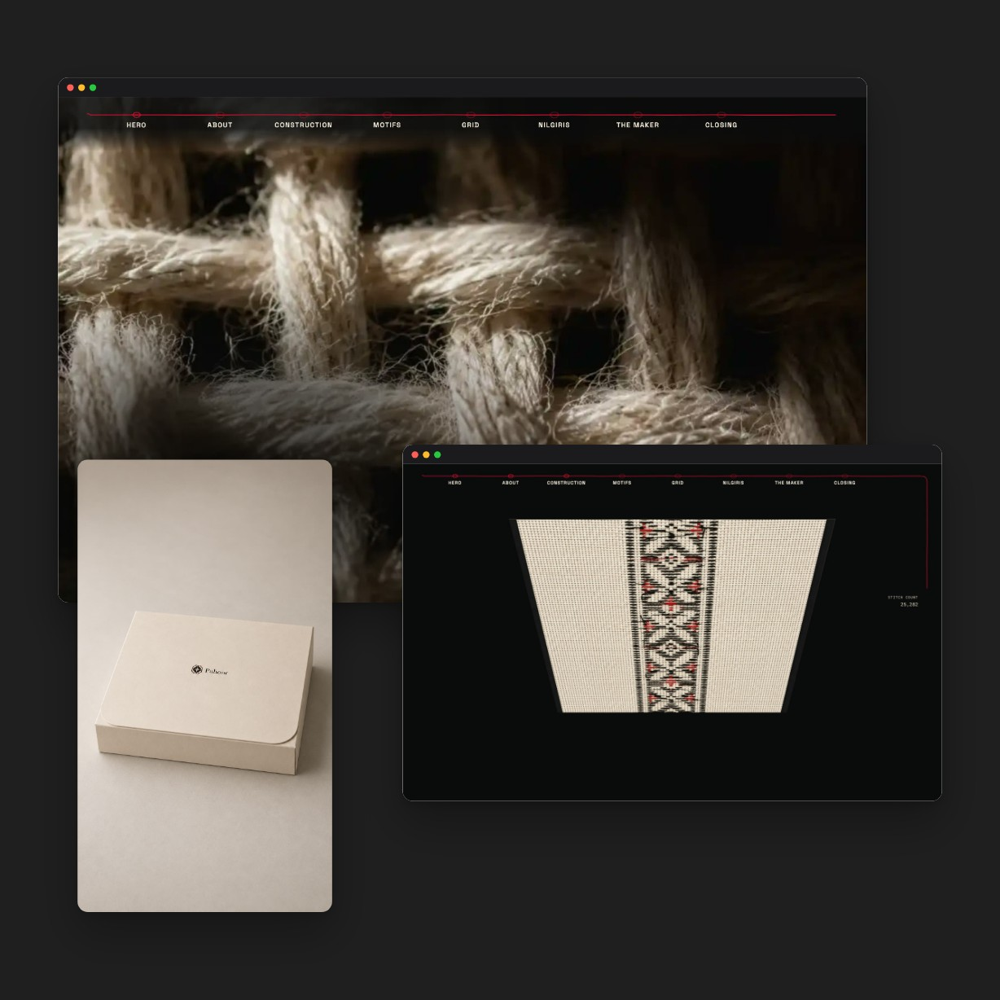

# Puhoor: Toda Embroidery, The Side We Misread

An interactive, scroll-driven exhibition about Toda embroidery, a hand-embroidery tradition of the Nilgiri hills. It follows the cloth from raw thread to finished band across eight chapters, and ends with a counted-stitch grid that visitors can draw on themselves.

**Live site:** https://puhoor-toda-embroidery.vercel.app/



## What it does

- **Eight scroll chapters:** Hero, About, Construction, Motifs, The counted grid, The Nilgiris, Artisans and Closing. Every narrative movement is driven by scroll and is fully reversible.
- **Counted-stitch grid:** click or drag to place stitches; marks mirror across a centre axis, like the real pattern.
- **Thread navigation:** a thread that tracks your position through the chapters.
- **Frame-sequence engine:** the hero and several chapters play scroll-scrubbed image sequences from a resilient loader (`src/lib/sequence.ts`).
- **Film grain and colour grade** applied as global layers.
- **Desktop-first:** visitors who prefer reduced motion load only a few representative frames, and phones do not load the sequence runtime.

## Tech

Vite, TypeScript, GSAP and Lenis. Fonts: Fraunces, Space Grotesk and IBM Plex Mono. No framework.

```bash
npm install
npm run dev      # local development
npm run build    # type-check and production build into dist/
```

The design is documented in [`SPEC.md`](SPEC.md) (tokens, type scale, the chapter contract, the sequence engine and the motion rules), and the site copy in [`COPY.md`](COPY.md).

## How it was built

Designed and directed by Karan. The code was written spec-first with an AI coding assistant working from `SPEC.md`, and every image on the site is AI-generated and labelled as such on the site itself.

## Credits and imagery

All imagery is AI-generated, produced using documentary photographs of real Toda cloth as visual reference. No image is a photograph of a real cloth, artisan or place. The source photographs are not included in this repository. The motif traces are exhibition reconstructions, not scholarly diagrams.

Sources used for the research and copy:

- Geographical Indications Registry, Intellectual Property India: "Toda Embroidery", Application 135.
- Development Commissioner (Handicrafts), Ministry of Textiles, Government of India: "Toda Embroidery" and the geographical-indications craft compendium.
- People's Archive of Rural India: "'Copying our designs is not correct.'"
- Asia InCH / Global InCH: "Toda Tribal Embroidery of Nilgiri, Tamil Nadu."
- Garima Sharma and Simmi Bhagat: "Revival of Toda Embroidery: Needlecraft of Nilgiris."

## Rights

© Karan. All rights reserved: the code and written copy are shown here for review. Please ask before reusing them.
